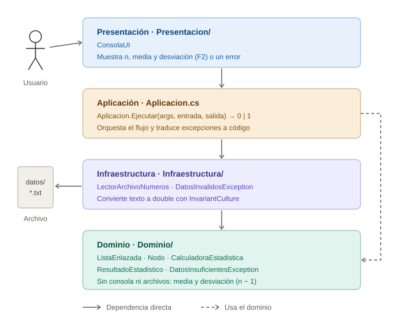
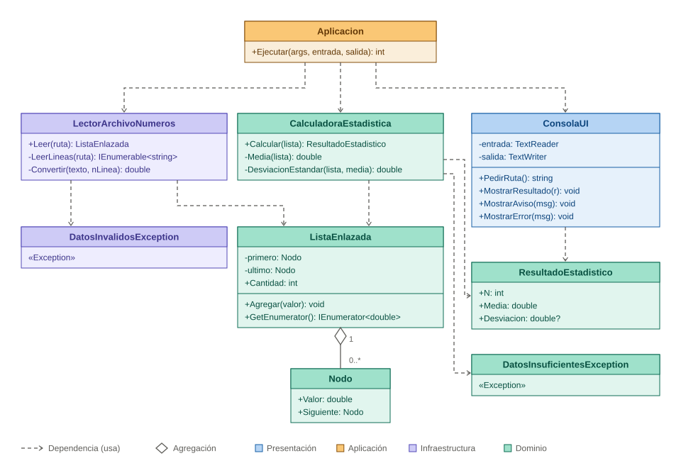
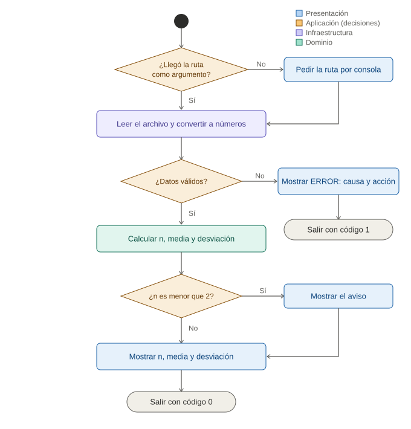
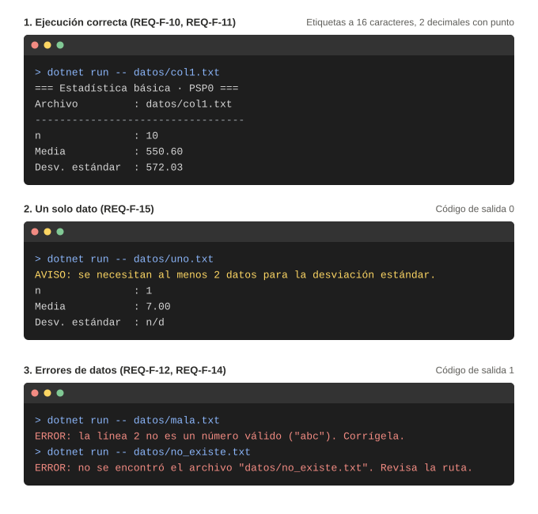

# Diseño · Programa 1 (media y desviación estándar)

Entradas de esta fase: `docs/planeacion/requisitos_programa1_estadistica.md` (REQ-F-01 a REQ-F-15, REQ-NF-01 a REQ-NF-10).
Salidas: este documento, `pseudocodigo.md` y los diagramas de `diagramas/`.

## 1. Arquitectura en capas

| Capa | Carpeta | Responsabilidad | Requisitos |
|---|---|---|---|
| Presentación | `Presentacion/` | Pedir la ruta, mostrar resultados, avisos y errores por consola. | REQ-F-02, REQ-F-10, REQ-F-11, REQ-NF-06 |
| Aplicación | `Aplicacion.cs` | Orquestar: ruta → leer → calcular → mostrar; traducir excepciones a código de salida. | REQ-F-01, REQ-F-12 a 15, REQ-NF-04 |
| Infraestructura | `Infraestructura/` | Leer el archivo y convertir texto a `double` con cultura invariante. | REQ-F-03, REQ-F-04, REQ-NF-02 |
| Dominio | `Dominio/` | Lista enlazada y estadísticos; no conoce la consola ni los archivos. | REQ-F-05 a 09, REQ-NF-03, REQ-NF-05 |

**Regla de dependencia:** las flechas van hacia el dominio y el dominio no depende de ninguna otra capa, por eso se prueba sin archivos ni consola.
La consola se inyecta como `TextReader` y `TextWriter` para probar `Aplicacion.Ejecutar` con `StringReader` y `StringWriter`.

## 2. Diagrama de clases (UML)

* `ListaEnlazada` guarda el puntero al **último** nodo: agregar es O(1) y 100 000 datos caben en menos de 1 s (REQ-NF-05).
* Si *n* < 2, `ResultadoEstadistico.Desviacion` queda en `null` y la interfaz muestra un aviso en vez de un error (REQ-F-15).
* `DatosInvalidosException` cubre archivo inexistente, vacío o con líneas no numéricas; `DatosInsuficientesException` protege el cálculo con lista vacía.
* Todo el cálculo usa `double`, suficiente para el margen de ±0.01 (REQ-NF-03).

## 3. Flujo del programa (diagrama de actividad)

## 4. Diseño de la interfaz (consola)

* Encabezado fijo de tres líneas (título, archivo y separador).
* Etiquetas alineadas a 16 caracteres para que los valores queden en columna.
* Dos decimales con punto, sin importar la cultura del sistema (REQ-F-11, REQ-NF-02).
* Errores y avisos en una sola línea que empieza por `ERROR:` o `AVISO:` y dice qué corregir (REQ-NF-06). Los errores terminan con código de salida 1.

## 5. Datos

**No se usa base de datos.** El enunciado pide leer *n* números de un archivo y guardarlos en memoria en una lista enlazada;
una base de datos agregaría instalación y configuración sin aportar a ningún requisito.
Formato del archivo de entrada: texto plano UTF-8, un número real por línea, punto decimal; se ignoran las líneas en blanco y las que empiezan por `#`.

> Si un programa posterior necesita persistencia, en esta sección va el modelo entidad-relación y el script `CREATE TABLE`.

## 6. Trazabilidad requisito → diseño

| Requisito | Clase / método | Caso de prueba |
|---|---|---|
| REQ-F-01 | `Aplicacion.Ejecutar` (lee `args`) | CP-11 |
| REQ-F-02 | `ConsolaUI.PedirRuta` | CP-12 |
| REQ-F-03 | `LectorArchivoNumeros.Leer` | CP-01, CP-02 |
| REQ-F-04 | `LectorArchivoNumeros.LeerLineas` | CP-06 |
| REQ-F-05, 06 | `ListaEnlazada.Agregar`, `Cantidad` | CP-13 |
| REQ-F-07 | `CalculadoraEstadistica.Media` | CP-01 a CP-03 |
| REQ-F-08 | `CalculadoraEstadistica.DesviacionEstandar` | CP-01 a CP-03 |
| REQ-F-09 | `CalculadoraEstadistica.DesviacionEstandar` | CP-04 |
| REQ-F-10, 11 | `ConsolaUI.MostrarResultado` | CP-14 |
| REQ-F-12 | `LectorArchivoNumeros.Leer` + `Aplicacion.Ejecutar` | CP-07 |
| REQ-F-13 | `LectorArchivoNumeros.Leer` + `Aplicacion.Ejecutar` | CP-08 |
| REQ-F-14 | `LectorArchivoNumeros.Convertir` | CP-09 |
| REQ-F-15 | `CalculadoraEstadistica.Calcular` + `ConsolaUI.MostrarAviso` | CP-05 |
| REQ-NF-02 | `LectorArchivoNumeros.Convertir` (cultura invariante) | CP-10 |
| REQ-NF-03 | Cálculo en `double` | CP-01, CP-02 |
| REQ-NF-04 | Captura de excepciones en `Aplicacion.Ejecutar` | CP-07 a CP-09 |
| REQ-NF-05 | Lista con puntero al último nodo | CP-15 |
| REQ-NF-06 | Mensajes de la interfaz | CP-07 a CP-09 |

### Casos de prueba referenciados

| Id | Caso | Resultado esperado |
|---|---|---|
| CP-01 | Columna 1 de la Tabla 1 | Media 550.60; desviación 572.03 |
| CP-02 | Columna 2 de la Tabla 1 | Media 60.32; desviación 62.26 |
| CP-03 | `-2`, `2` | Media 0.00; desviación 2.83 |
| CP-04 | `5`, `5`, `5` | Desviación 0.00 |
| CP-05 | Un solo dato (`7`) | Media 7.00; aviso; desviación `n/d` |
| CP-06 | Líneas en blanco y comentarios `#` | Mismo resultado que sin ellos |
| CP-07 | Archivo inexistente | `ERROR:` y código 1 |
| CP-08 | Archivo vacío | `ERROR:` y código 1 |
| CP-09 | Línea 2 con `abc` | `ERROR:` que indica la línea 2 |
| CP-10 | «15.0» con cultura `es-CO` | Se lee como 15.0 |
| CP-11 | Ruta como argumento | Procesa sin pedir nada |
| CP-12 | Sin argumento | Pide la ruta por consola |
| CP-13 | Lista con 3 valores | Conserva el orden y `Cantidad` = 3 |
| CP-14 | Formato de salida | 2 decimales y punto |
| CP-15 | 100 000 datos | Menos de 1 segundo |
